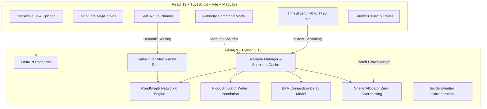

# SafeRoute: Disaster-Aware Evacuation Platform

A deterministic disaster-response simulation and navigation platform that models how roads, floods, crowd congestion, and shelter capacity evolve over time, dynamically recalculating safe evacuation routes.



---

## Quick Start (Run Locally)

### 1. Start the Backend API (Terminal 1)
```bash
cd backend
uv run --python .venv uvicorn app.main:app --host 0.0.0.0 --port 8000 --reload
```
* API Server: `http://localhost:8000`
* Interactive OpenAPI Docs: `http://localhost:8000/docs`
* Run Backend Tests (103 passing tests):
```bash
uv run --python backend/.venv pytest backend/tests/
```

### 2. Start the Frontend Application (Terminal 2)
```bash
cd frontend
npm run dev
```
* Web Dashboard: `http://localhost:5173`

---

## 3-Minute Hackathon Demo Script

1. **Initial Baseline (T + 0 min):**
   * Open `http://localhost:5173`. Notice all road segments in Riverdale are green (passable).
   * In the Safe Route Planner, select **Origin: Downtown Central Sector [N05]** and **Destination: Riverdale West High School [N09]**.
   * Click **Find Safe Evacuation Route**. Notice the system recommends crossing via **Bridge South [E15]** (fastest direct path).

2. **Advance Time Slider to T + 30 min:**
   * Scrub the slider to **T + 30m** (or click Play).
   * Observe simulated flood water expanding over Riverdale South basin.
   * **Bridge South turns Red (Closed)** as flood depth reaches 0.28m, exceeding the 0.18m threshold.
   * Notice the route recalculates automatically: the evacuee is redirected safely north via **Bridge North [E13]**.

3. **Wheelchair Step-Free Accessibility:**
   * Change destination to **Hilltop Emergency Plateau [N12]**.
   * With **Pedestrian** mode, the route takes the direct steep stone stairs (N11 to N12).
   * Switch profile to **Wheelchair**. The system enforces hard accessibility constraints, rejecting stairs and routing around via the paved road ramp.

4. **Crowd Assignment & Zero Overbooking:**
   * Open the **Shelters** tab on the right sidebar.
   * Click **Simulate Crowd Evacuation (Zero Overbooking)**.
   * The allocator fills the closest available shelters up to 100% capacity, then redirects overflow crowds to remaining open shelters without exceeding limits.

5. **Authority Override & Incident Reports:**
   * Click **Authority Console** in the top navigation.
   * Force close or reopen any bridge segment, or submit a citizen flood report and verify it.
   * The entire scenario timeline updates immediately.
